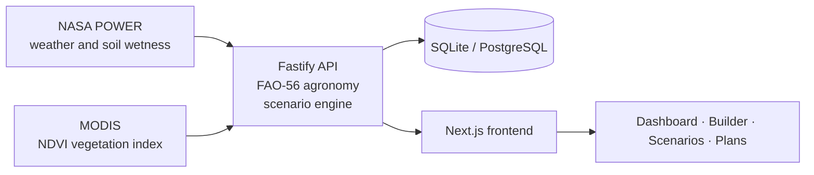

<div align="center">

```
┌──────────────────────────────────────────────────────────┐
│                                                          │
│   F A R M S H I F T                                      │
│   ─────────────────                                      │
│   plan the next season before you plant it               │
│                                                          │
│   ░░▒▒▓▓██  satellite  ·  weather  ·  agronomy  ██▓▓▒▒░░ │
│                                                          │
└──────────────────────────────────────────────────────────┘
```

**A crop-rotation planner driven by real satellite and climate data.**
Pick a field, describe your soil and goals, and compare rotation scenarios side by side.

[Quick start](#-quick-start) · [How it works](#-how-it-works) · [What's real](#-what-is-real-and-what-is-modelled) · [Commands](#-commands) · [Production](#-going-to-production) · [Troubleshooting](#-troubleshooting)

</div>

---

## ▍ At a glance

| | |
|---|---|
| **Frontend** | Next.js app: dashboard, farm setup, rotation builder, scenario comparison |
| **Backend** | Fastify API with an interactive OpenAPI explorer at `/docs` |
| **Climate data** | NASA POWER: temperature, rainfall, soil wetness |
| **Vegetation data** | MODIS NDVI satellite index, per field coordinates |
| **Agronomy** | FAO-56 Penman-Monteith evapotranspiration |
| **Storage** | SQLite by default (Node built-in), PostgreSQL optional |
| **AI layer** | Optional Claude-written explanations; the app works fully without them |

```
farmshift/            Next.js frontend, wired to the API
farmshift-backend/    Fastify API, data providers, rotation scenario engine
scripts/              one-command setup and launcher
docs/                 deployment guide
```

---

## ▍ Quick start

> **Requires Node 22.13 or newer.** The backend uses Node's built-in SQLite.
> Check with `node -v`. If it is older, install the current LTS from [nodejs.org](https://nodejs.org).

```bash
npm run setup     # install both projects          (once)
npm run init      # generate JWT secret + metrics token   (once)
npm run dev       # start frontend and backend together
```

| Service | Address |
|---|---|
| Frontend | http://localhost:3000 |
| API | http://localhost:4000 |
| API docs | http://localhost:4000/docs |

Stop everything with `Ctrl-C`. Config files are already in place (`farmshift/.env.local`, `farmshift-backend/.env`).

**Suggested first walk-through**

```
Dashboard  →  Farm Setup  →  Rotation Builder  →  Scenarios
  look at      enter soil,     choose crops,        compare the
  your field   water, goals    hit Generate         options
```

---

## ▍ How it works



The frontend sends your selected field's coordinates and your farm profile. The API pulls five years of
climate history, computes evapotranspiration, and runs the rotation engine. Results are cached, so a new
location is slow once (several seconds) and fast afterwards.

---

## ▍ What is real, and what is modelled

| Screen | Where the numbers come from |
|---|---|
| **Dashboard** | NASA POWER and MODIS NDVI for the selected field; ET from FAO-56 Penman-Monteith |
| **Farm Setup** | Your soil, crop, water and priorities, which feed every scenario |
| **Rotation Builder** | *Generate* calls the engine; your crop picks set the cycle length and appear in every scenario |
| **Scenarios, Comparison, Trade-offs, AI Insights** | Computed per field and profile. "Current Plan" is the real baseline: continuing your current crop |

### Data fallback chain

```
 live NASA data  ──(unreachable)──▶  cached data  ──(none)──▶  labelled synthetic model
```

Whenever synthetic data is in use, the dashboard and scenarios pages show an amber
**"modelled demo data, not observations"** banner. Working offline? Set
`ENV_PROVIDER=synthetic` in `farmshift-backend/.env`. The default is `ENV_PROVIDER=auto`.

### Accounts are optional

The whole app works anonymously. If you sign in you can save scenarios as plans.

- Sessions are `HttpOnly` cookies. No credential is ever kept in `localStorage`.
- Stale or revoked sessions are cleared by the server and never break a page.
- Password reset works by email (needs SMTP, see the deployment guide).

---

## ▍ Commands

```bash
npm test                      # ~150 backend tests, no network needed (SQLite)
npm run typecheck             # backend + frontend
npm run smoke:live            # needs internet: checks NASA POWER + MODIS against the real services
npm run backup                # consistent snapshot of the database
npm run set-key -- ANTHROPIC_API_KEY=sk-ant-...   # optional AI explanations
```

Run the same test suite against PostgreSQL (~160 tests):

```bash
TEST_DATABASE_URL=postgres://... npm test
```

---

## ▍ Frontend change log

<details>
<summary><b>Files changed or added when the frontend was connected to the API</b> (click to expand)</summary>

<br>

**Rewired existing files**

| File | Change |
|---|---|
| `src/services/api.ts` | Mock data replaced by an HTTP client for the backend. Same function names, plus scenario-run helpers |
| `src/app/dashboard/page.tsx` | Sends the field's coordinates; error handling; synthetic-data banner |
| `src/app/scenarios/page.tsx` | Loads scenarios from the backend instead of `mockScenarios`; loading and error states |
| `src/app/rotation-builder/page.tsx` | *Generate* sends your rotation to the backend behind the existing progress animation; shows errors |
| `src/components/scenarios/ScenarioComparison.tsx` | Takes the real `baseline` as a prop instead of the mock `currentPlanMetrics` |
| `src/types/index.ts` | Adds optional `meta` and `score` fields to `EnvironmentSummary` |
| `src/components/layout/Navbar.tsx` | Adds the account menu (Sign in / My Plans / Sign out) |

**New files**

| File | Purpose |
|---|---|
| `src/hooks/useScenarioRequest.ts` | Builds the backend request from the selected field and farm-profile store |
| `src/store/auth.ts` | Session state for the UI |
| `src/components/layout/AccountMenu.tsx` | The account menu |
| `src/components/scenarios/SavePlanButton.tsx` | "Save as a plan" on the Scenarios page |
| `src/app/login/page.tsx` | Sign in and register |
| `src/app/plans/page.tsx` | Saved-plans list |
| `src/app/forgot-password/page.tsx` | Request a reset email |
| `src/app/reset-password/page.tsx` | Choose a new password from the emailed link |
| `.env.local` | `NEXT_PUBLIC_API_URL=http://localhost:4000/api/v1` |
| `Dockerfile`, `.dockerignore` | Production image for the frontend |

The mock files in `src/data/` are still used for the farm and crop pickers. Their ids match the backend's
seeded demo farms and crop catalog.

</details>

---

## ▍ Going to production

Full guide: [`docs/DEPLOYMENT.md`](docs/DEPLOYMENT.md). It covers Docker Compose with automatic HTTPS (Caddy),
backups, metrics, which API keys exist, and an honest list of what the setup does not cover
(PostgreSQL option, SMTP for reset emails, backups).

```bash
npm run init:prod -- your.domain.com
docker compose --env-file .env.production up -d --build
```

CI in `.github/workflows/ci.yml` runs typecheck, tests, builds and Docker builds.

---

## ▍ Troubleshooting

| Symptom | Fix |
|---|---|
| **"Cannot reach the FarmShift API"** in the UI | The backend is not running. Start both with `npm run dev` from the repo root |
| **`node:sqlite` or "Unexpected token" errors** | Node is too old. Upgrade to 22.13+ |
| **Port 3000 is busy** | Next moves to 3001. In development the API accepts any `localhost` port, so it still works |
| **First load of a new location is slow** | It is fetching 5 years from NASA. Repeat loads come from the cache |
| **`next build` fails offline** | The build downloads Google Fonts. `next dev` is unaffected |

More detail on the API, methods and limits: [`farmshift-backend/README.md`](farmshift-backend/README.md).

---

<div align="center">

<sub>Released under the MIT License · Built with NASA POWER, MODIS and FAO-56</sub>

</div>
